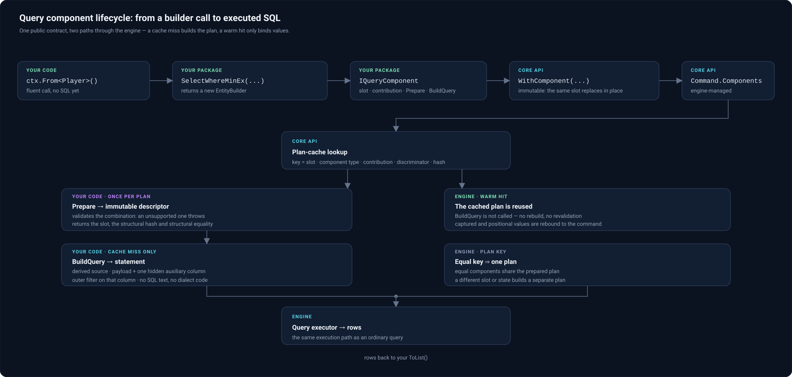

# Extensibility: custom SQL dialects and renderers

> nextorm renders SQL through an [`ISqlDialect`](xref:NextORM.Core.ISqlDialect); the supported extension boundary lets an external assembly supply its own dialect, for the native extreme-row strategy its own renderer, or a query component that adds structural behaviour to query construction — without friend access.

**Prerequisites:** [Native extreme-row strategies (`SelectWhereMax` / `SelectWhereMin`)](select-where-extrema-native.md) · [Provider overview](../connecting-providers/overview.md) · [API quick reference](api-reference.md)

## Overview

The native extreme-row strategy is a public dialect capability, not a hard-coded provider branch:

- [`ISqlDialect.ExtremeRowRenderer`](xref:NextORM.Core.ISqlDialect.ExtremeRowRenderer) is the optional renderer, declared as a default interface member returning `null`; [`SqlDialectBase.ExtremeRowRenderer`](xref:NextORM.Core.SqlDialectBase.ExtremeRowRenderer) overrides it virtually with the same default. `null` means no native strategy.
- [`IExtremeRowRenderer`](xref:NextORM.Core.IExtremeRowRenderer) exposes `CanRender(`[`ExtremeRowDescription`](xref:NextORM.Core.ExtremeRowDescription)`)`, a side-effect-free decision taken before any SQL is assembled, and `Render(`[`ExtremeRowRenderRequest`](xref:NextORM.Core.ExtremeRowRenderRequest)`)`, which returns the winning-row source. Only a positive `CanRender` leads to `Render`, and `Render` has no late fallback to the portable path.
- [`ExtremeRowRenderColumn`](xref:NextORM.Core.ExtremeRowRenderColumn), [`ExtremeRowDescription`](xref:NextORM.Core.ExtremeRowDescription) and [`ExtremeRowRenderRequest`](xref:NextORM.Core.ExtremeRowRenderRequest) carry only shape facts (CLR type, nullability, direct-mapped/converter flags, and the prepared source/aliases), never the expression or build context. See the [API quick reference](api-reference.md).
- Each of the three DTOs also exposes a **public eager constructor**, so an assembly without friend access can build them and drive its own [`IExtremeRowRenderer`](xref:NextORM.Core.IExtremeRowRenderer). Construction validates references and collection elements immediately and structurally: a required reference that is `null` throws `ArgumentNullException`; a `null` element, an empty-string alias element or a `SourceSql` that is empty/whitespace-only throws `ArgumentException`; an undeclared `KeywordCase` value throws `ArgumentException`. It performs **no** SQL parsing or provider-type/security validation, adds no minimum-count, cross-list cardinality or alias-disjointness rule (empty shapes and overlapping aliases are allowed), never reads `ExtremeRowDescription.Payload`, and never calls `CanRender`/`Render`. The collections are **borrowed**, not copied and not made immutable: the same instance is observed through the property, and a caller must not mutate it while the DTO is in use, including from a concurrent caller. The core's internal lazy payload/candidate-preparation path (and the unvalidated trusted request construction used on the hot path) remains an implementation detail and is **not** public API.

`PostgresDialect` and `ClickHouseDialect` are deliberately **not `sealed`**: keeping them inheritable, together with their public constructors (`PostgresDialect()`, `PostgresDialect(Version?)`, `ClickHouseDialect()`), the shared `Instance` singleton and the virtual `ExtremeRowRenderer` hook, is the supported external extension boundary — a public compatibility commitment, not a test detail. A custom dialect can derive from either provider dialect, override the hook and install its own public [`IExtremeRowRenderer`](xref:NextORM.Core.IExtremeRowRenderer) implementation; the built-in renderers (`PostgresExtremeRowRenderer`, `ClickHouseExtremeRowRenderer`) are `internal` and are not part of that contract. Returning `null` from the override — or installing a renderer whose `CanRender` answers `false` — keeps the portable window-function lowering, and the provider defaults and constructors are unchanged.

## Creating a custom dialect

```csharp
// A non-friend assembly subclasses the provider dialect and installs a custom renderer.
public sealed class MyPostgresDialect : PostgresDialect
{
    public override IExtremeRowRenderer? ExtremeRowRenderer => MyRenderer.Instance;
}

// Only the global (ungrouped) single-key form is handled natively; every other shape
// falls back to the portable lowering because CanRender answers false.
public sealed class MyRenderer : IExtremeRowRenderer
{
    public static readonly MyRenderer Instance = new();

    public bool CanRender(ExtremeRowDescription description)
        => description.Groups.Count == 0 && description.Keys.Count == 1;

    public string Render(ExtremeRowRenderRequest request)
    {
        var direction = request.IsMax ? "desc" : "asc";
        return request.SourceSql
            + " order by \"" + request.KeyAliases[0] + "\" " + direction + " limit 1";
    }
}

// The second example: returning null from the override forces the portable window-function
// lowering for every request, without installing a renderer.
public sealed class PortablePostgresDialect : PostgresDialect
{
    public override IExtremeRowRenderer? ExtremeRowRenderer => null;
}
```

## Registering a custom dialect

Creating the dialect subclass is only half of it — the context has to be told to use it. [`DataContext.Dialect`](xref:NextORM.Core.DataContext.Dialect) is an **`abstract`** property (`src/nextorm.core/DataContext/DataContext.cs:153`), and every provider context overrides it to return its built-in dialect: `PostgresDataContext` and `MariaDbDataContext` return the instance they built at construction, while `SqliteDataContext`, `MySqlDataContext`, `SqlServerDataContext` and `ClickHouseDataContext` return a shared `Instance` singleton. There is no `DataContextBuilder`/`UseDialect` switch; the supported way to install a custom dialect is to subclass the **provider context** and override `Dialect` to return your dialect:

```csharp
public sealed class MyPostgresDataContext : PostgresDataContext
{
    private readonly ISqlDialect _dialect = new MyPostgresDialect();

    public MyPostgresDataContext(string connectionString, DataContextBuilder builder)
        : base(connectionString, builder)
    {
    }

    public override ISqlDialect Dialect => _dialect;
}

using var ctx = new MyPostgresDataContext(connectionString, new DataContextBuilder());

// Reaches the database through MyPostgresDialect → MyRenderer.
var top = ctx.From<Player>().SelectWhereMax(p => p.Score).ToList();
```

The same shape works for `MyClickHouseDataContext : ClickHouseDataContext` (`ClickHouseDialect` is likewise not `sealed`). The plan cache is keyed by the **context type**, so derive a distinct `DataContext` subclass per dialect — the same rule the PostgreSQL server-version guard already states. Installing a dialect that returns `null` from `ExtremeRowRenderer` (or a renderer whose `CanRender` answers `false`) keeps the portable window-function lowering.

## Extending query construction with query components

A **query component** lets a third-party package add structural behaviour to query construction without a core
change per operator, friend access, a global registry or raw SQL. A component carries its own slot identity,
its preparation/validation logic and its structural build handler, and attaches to an immutable builder through
[`WithComponent`](xref:NextORM.Core.EntityBuilder`1.WithComponent(NextORM.Core.IQueryComponent)):

```csharp
var top = ctx.From<Player>()
    .ExternalSelectWhereMin(p => p.Score)   // an ordinary extension method from the package
    .ToList();
```

### Why the contract exists

The engine renders SQL from its own expression tree, so a new query shape can normally be added in only three
ways: change the core, take friend access, or emit SQL text. The component contract is the fourth way: you
describe the *structure* the operator needs in terms of the engine's own primitives, and the engine decides
**when** to call you — so your operator inherits the plan cache, the parameter binding and the
provider-independence of an ordinary query instead of re-implementing them.

Nothing here is a registry and nothing is global. A component is an object attached to one immutable builder:
its lifetime is the lifetime of the query, and two components of the same slot never nest.

### Who implements what, and who calls it

| Type | You | The engine |
|---|---|---|
| [`IQueryComponent`](xref:NextORM.Core.IQueryComponent) | Implement it: one object per operator instance. | Reads `Slot` when the component is attached and when a plan key is compared; reads `Contribution` and calls `Prepare` while preparing; calls `BuildQuery` while rendering. |
| [`IQueryComponentDescriptor`](xref:NextORM.Core.IQueryComponentDescriptor) | Return it from `Prepare`; it must be immutable and must not reference mutable component state. | Stores it in [`QueryCommand.PreparedComponents`](xref:NextORM.Core.QueryCommand.PreparedComponents), hashes it (`StructuralHash`) and compares it (`StructurallyEquals`) as part of the plan key, and drops it on a reset of the preparation. |
| [`QueryComponentContribution`](xref:NextORM.Core.QueryComponentContribution) | Declare it once per operator: `AdditivePredicate` or `ExclusiveRowSource`. | Rejects a second `ExclusiveRowSource` slot while preparing and combines `AdditivePredicate` contributions with `AND`. |
| [`IQueryComponentPrepareContext`](xref:NextORM.Core.IQueryComponentPrepareContext) | Consume it in `Prepare`. | Creates it over the command being prepared. |
| [`IQueryComponentBuildContext`](xref:NextORM.Core.IQueryComponentBuildContext) | Consume it in `BuildQuery`. | Creates it over the rebuilt command (step 4 below). |
| [`QueryComponentContext`](xref:NextORM.Core.QueryComponentContext) | Normally never touch it; it is public so tests can drive a component directly. | Implements both context interfaces and resolves `ExpressionComparer` from the command — compare selectors with it, not with `Expression.Equals`. |
| [`IQueryComponentShape`](xref:NextORM.Core.IQueryComponentShape) | Optional: implement it to let the raw (pre-preparation) recipe cache serve your component — report its scalar state and its selectors. | Compares `ShapeState` with `Equals` and the selectors with the expression comparer when matching a fresh command against a cached raw shape; a component that does not implement it keeps the ordinary preparation route. |
| [`WithComponent`](xref:NextORM.Core.EntityBuilder`1.WithComponent(NextORM.Core.IQueryComponent)) | Call it from your extension method. | Copies the builder and replaces a same-slot component in place. |
| [`QueryCommand.Components`](xref:NextORM.Core.QueryCommand.Components) / [`PreparedComponents`](xref:NextORM.Core.QueryCommand.PreparedComponents) | Read only, for diagnostics. | Owned, published and cleared by the engine. |

### When each call happens

1. **Attach** — your extension method calls `WithComponent`. Copy-on-write: the builder is cloned, a same-slot
   component is replaced, a different slot is appended. Nothing is validated at this point.
2. **`Prepare`** — the planner calls it once for every attached component while preparing the command
   (`src/nextorm.core/Query/QueryCommand.QueryPreparer.cs`), that is once per *preparation*, which is once per
   plan build. It runs again only when the same command is prepared again — a second `DataContext`, a template
   re-prepared from the cache, a reset of the preparation. This is where you validate and reject.
3. **Descriptor → plan key** — the returned descriptor lands in `QueryCommand.PreparedComponents`; the plan key
   hashes `StructuralHash` and compares descriptors with `StructurallyEquals` on a warm lookup
   (`src/nextorm.core/Query/QueryPlanEqualityComparer.cs`, `src/nextorm.core/DataContext/Cache/QueryPlan.cs`).
   Two structurally equal components therefore share one cached plan.
4. **`BuildQuery`** — on the plan build only, `SqlBuilder.MakeSelect`
   (`src/nextorm.core/DataContext/SqlBuilder.cs`) clones the prepared command, calls `BuildQuery` on the clone
   for every component, and renders the clone. Your handler mutates a throwaway copy, never the command the
   caller holds.
5. **Execute** — the SQL is stored on the plan. A warm cache hit reuses it: `BuildQuery` is not called and the
   descriptor is not rebuilt, while captured values and positional parameters are rebound against the original
   command. The parameter-refresh re-render reuses the shape the miss built, so it does not call `BuildQuery`
   again either.

In practice: **you never call `Prepare` or `BuildQuery` yourself**, and SQL text never reaches your code.

### Rules the contract imposes on your implementation

- **Prepare/validate → an immutable prepared descriptor.** It validates the combination — an unsupported one
  throws instead of being composed arbitrarily — and returns a descriptor carrying the slot, the concrete
  component type, the contribution kind, a semantic `Discriminator`, a `StructuralHash` over the full state and
  `StructurallyEquals`. The descriptor is immutable and shared by the cached plan, so it must not reference
  mutable component state.
- **Structural construction on the cache miss.** `BuildQuery` receives the command through
  `IQueryComponentBuildContext` and rebuilds the statement from engine primitives: a derived source
  (`FromExpression`), the original select list plus a hidden auxiliary column (`SelectExpression`,
  `SetComponentSelectList`), an optional rewritten predicate (`SetComponentPreparedCondition`) and cleared
  sorting. It never renders SQL text — the engine does.
- **Slot identity.** `Slot` is the stable identity of a logical operator. Attaching a component whose slot is
  already present **replaces it in place**; the builder and the command never nest two components of one slot.
  `Min` and `Max` of the same operator family therefore share a slot and replace each other. `AdditivePredicate`
  components compose — each contributes a predicate combined with `AND` — while at most **one**
  `ExclusiveRowSource` slot may be present: two distinct exclusive slots are rejected during preparation with a
  [`BuildSqlCommandException`](xref:NextORM.Core.BuildSqlCommandException).
- **Hidden-column collision safety.** An auxiliary column must neither leak into the result nor collide with a
  mapped column. Derive its alias from the target metadata ([`DataContextCache.Metadata`](xref:NextORM.Core.DataContextCache.Metadata)),
  keep it out of the outer select list and read it back through the typed
  [`SqlFunctions.Column<T>`](xref:NextORM.Core.SqlFunctions.Column``1(System.Object,System.String)) primitive, so
  a user column named `rn`, `rank` or `__nextorm_ext_rn` can neither collide nor surface.
- **No in-memory support.** A component whose semantics are SQL-only rejects `InMemoryDataContext` in `Prepare`
  with `NotSupportedException`; it must not silently degrade or return different rows.

### How a component travels through the engine



The picture is the whole contract: your package contributes a component, the engine prepares it once per plan and
builds the SQL from it, and every later call reuses the cached plan with `BuildQuery` never running again.

A **synthetic** component — the smallest thing that shows the shape. It is deliberately not a working operator:
the statement, the auxiliary column and the prepared state are the parts you design, and the
[extensions package](extensions-package.md) is the shipped reference implementation of a complete one.

```csharp
public static class MyOperatorExtensions
{
    // An ordinary extension method: no registration, no core change, no raw SQL.
    public static EntityBuilder<TEntity> SelectWhereBestEx<TEntity, TValue>(
        this EntityBuilder<TEntity> source,
        Expression<Func<TEntity, TValue>> valueSelector)
        => source.WithComponent(new BestRowComponent<TEntity>(valueSelector));
}

internal sealed class BestRowComponent<TEntity> : IQueryComponent
{
    private readonly LambdaExpression _valueSelector;

    public BestRowComponent(LambdaExpression valueSelector) => _valueSelector = valueSelector;

    // One slot per logical operator: attaching another component of this family replaces it in place.
    public Type Slot => typeof(BestRowComponent<TEntity>);

    // What the operator contributes: an additive predicate or the single exclusive row source.
    public QueryComponentContribution Contribution => QueryComponentContribution.ExclusiveRowSource;

    // Runs once per plan build, against the command being prepared. Reject what the shape cannot express
    // (throw, never compose arbitrarily) and return immutable state the plan cache can key on.
    public IQueryComponentDescriptor Prepare(IQueryComponentPrepareContext context)
    {
        RejectUnsupportedModifiers(context.Command);
        return new Descriptor(Slot, _valueSelector, context.ExpressionComparer);
        //      ^ slot, contribution, discriminator, StructuralHash, StructurallyEquals
    }

    // Runs on the cache miss only. Restate the query from engine primitives — never from SQL text.
    public void BuildQuery(IQueryComponentBuildContext context)
    {
        var inner = context.Command.Clone();            // derived source, payload preserved
        // inner.SetComponentSelectList(<payload>, <auxiliary column>);
        // inner.SetComponentPreparedCondition(<auxiliary column> == <surviving rows>);
        inner.SetComponentSorting(null);                // ordering belongs to the operator
        context.Command.From = new FromExpression(inner);
    }
}
```

Everything concrete stays yours: which rows survive, the auxiliary column you add and the alias you give it, the
combinations you reject. The engine owns quoting, aliases and parameter binding, so the same component renders on
every SQL provider without dialect-specific code — and on a warm cache hit it is not involved at all: the cached
plan is returned and captured/positional parameters are rebound against the original, unmodified command.

## See also

- [Extensions package (`nextorm.extensions`)](extensions-package.md) — a complete component-based operator
- [Native extreme-row strategies (`SelectWhereMax` / `SelectWhereMin`)](select-where-extrema-native.md)
- [API quick reference](api-reference.md)
- [Provider overview](../connecting-providers/overview.md)

---

Source: `src/nextorm.core/DataContext/Dialect/**`, `src/nextorm.core/Query/QueryComponents.cs`, `src/nextorm.postgres/**`, `src/nextorm.clickhouse/**` (XML doc comments are the authoritative API documentation).
