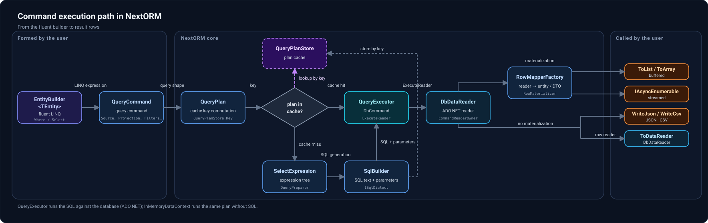

I've been developing Nextorm, an ORM library for .NET, for quite a while now. With the advent of agentic development tools, the process has become noticeably faster and easier, but for me it remains a large and serious engineering project. Today I'd like to present an important milestone in this work: the first stable release, 1.0.9.

The idea behind Nextorm is to combine Dapper-level performance with the convenience of automatically generating SQL from C# constructs. Instead of writing SQL manually, developers describe queries using strongly typed expressions, with compile-time checks of types and property access, IntelliSense support, and familiar refactoring tools.

For example:
```csharp
var row = dataContext.From<SimpleEntity>()
    .Where(x => x.Id == 1)
    .Select(x => new { x.Id })
    .Single();
```

In concept and spirit, Nextorm is closer to LINQ to SQL. However, the library uses its own API based on C# expression trees rather than a standard LINQ provider. These trees are used to generate SQL and build efficient mappers from query results to .NET types. In JIT mode, mapping expressions are compiled into delegates and then reused when reading data from the database.



The library supports SQLite, SQL Server, PostgreSQL, MySQL, MariaDB, and ClickHouse. The API covers a wide range of features of these database systems: joins, grouping, CTEs, window functions, and provider-specific constructs. It's important to me that developers don't have to switch to handwritten SQL as soon as a query becomes more complex than a simple select.

[https://alexeyshirshov.github.io/nextorm/guide/provider-specific-sql/overview.html](https://alexeyshirshov.github.io/nextorm/guide/provider-specific-sql/overview.html)

Performance has been one of the key priorities from the beginning, with Dapper serving as the benchmark. In the published SQLite benchmarks, Nextorm delivers comparable performance in many scenarios and surpasses that benchmark in some. The results, measurement conditions, and test source code are available in the repository.

[https://alexeyshirshov.github.io/nextorm/comparisons/benchmarks.html](https://alexeyshirshov.github.io/nextorm/comparisons/benchmarks.html)

Below is a table of performance measurements for compiled/prepared queries across four libraries.

| Method | Nextorm | Dapper | linq2db | EF Core |
|---|:---:|:---:|:---:|:---:|
| [Data fetch](https://github.com/AlexeyShirshov/nextorm/blob/main/benchmarks/BenchmarkDotNet.Artifacts/results/NextORM.Benchmark.SqliteBenchmarkIteration-report-github.md) | **10.75 μs** | 15.80 μs | 16.50 μs | 38.46 μs |
| [Wide data fetch](https://github.com/AlexeyShirshov/nextorm/blob/main/benchmarks/BenchmarkDotNet.Artifacts/results/NextORM.Benchmark.SqliteBenchmarkLargeIteration-report-github.md) | **9.135 ms** | 9.883 ms | 10.594 ms | 10.998 ms |
| [Where](https://github.com/AlexeyShirshov/nextorm/blob/main/benchmarks/BenchmarkDotNet.Artifacts/results/NextORM.Benchmark.SqliteBenchmarkWhere-report-github.md) | **915.0 μs** | 1,378.8 μs | 1,432.3 μs | 3,540.1 μs |
| [Simulate work](https://github.com/AlexeyShirshov/nextorm/blob/main/benchmarks/BenchmarkDotNet.Artifacts/results/NextORM.Benchmark.SqliteBenchmarkSimulateWork-report-github.md) | **8.610 ms** | 27.766 ms | 418.616 ms | 109.613 ms |
| [Any](https://github.com/AlexeyShirshov/nextorm/blob/main/benchmarks/BenchmarkDotNet.Artifacts/results/NextORM.Benchmark.SqliteBenchmarkAny-report-github.md) | **923.5 μs** | 1,421.9 μs | 1,523.8 μs | 3,742.6 μs |
| [FirstOrDefault](https://github.com/AlexeyShirshov/nextorm/blob/main/benchmarks/BenchmarkDotNet.Artifacts/results/NextORM.Benchmark.SqliteBenchmarkFirst-report-github.md) | **93.64 μs** | 148.96 μs | 363.31 μs | 368.44 μs |
| [SingleOrDefault](https://github.com/AlexeyShirshov/nextorm/blob/main/benchmarks/BenchmarkDotNet.Artifacts/results/NextORM.Benchmark.SqliteBenchmarkSingle-report-github.md) | **92.38 μs** | 142.69 μs | 372.78 μs | 369.31 μs |
| [`CASE WHEN`](https://github.com/AlexeyShirshov/nextorm/blob/main/benchmarks/BenchmarkDotNet.Artifacts/results/NextORM.Benchmark.SqliteBenchmarkFeaturesFair-report-github.md) | **9.45 μs** | 14.64 μs | 15.43 μs | 36.91 μs |
| [CTE](https://github.com/AlexeyShirshov/nextorm/blob/main/benchmarks/BenchmarkDotNet.Artifacts/results/NextORM.Benchmark.SqliteBenchmarkFeaturesFair-report-github.md) | **9.89 μs** | 22.25 μs | 23.75 μs | — |
| [`SELECT DISTINCT`](https://github.com/AlexeyShirshov/nextorm/blob/main/benchmarks/BenchmarkDotNet.Artifacts/results/NextORM.Benchmark.SqliteBenchmarkFeaturesFair-report-github.md) | **11.44 μs** | 18.27 μs | 18.36 μs | 42.53 μs |
| [`EXCEPT`](https://github.com/AlexeyShirshov/nextorm/blob/main/benchmarks/BenchmarkDotNet.Artifacts/results/NextORM.Benchmark.SqliteBenchmarkFeaturesFair-report-github.md) | **11.41 μs** | 18.13 μs | 21.57 μs | 46.40 μs |
| [IN-list](https://github.com/AlexeyShirshov/nextorm/blob/main/benchmarks/BenchmarkDotNet.Artifacts/results/NextORM.Benchmark.SqliteBenchmarkFeaturesFair-report-github.md) | **12.79 μs** | 18.55 μs | 47.92 μs | 66.24 μs |
| [`INTERSECT`](https://github.com/AlexeyShirshov/nextorm/blob/main/benchmarks/BenchmarkDotNet.Artifacts/results/NextORM.Benchmark.SqliteBenchmarkFeaturesFair-report-github.md) | **10.59 μs** | 16.64 μs | 20.33 μs | 44.07 μs |
| [4-table join](https://github.com/AlexeyShirshov/nextorm/blob/main/benchmarks/BenchmarkDotNet.Artifacts/results/NextORM.Benchmark.SqliteBenchmarkFeaturesFair-report-github.md) | **13.27 μs** | 27.17 μs | 24.65 μs | 50.99 μs |
| [`LEFT JOIN`](https://github.com/AlexeyShirshov/nextorm/blob/main/benchmarks/BenchmarkDotNet.Artifacts/results/NextORM.Benchmark.SqliteBenchmarkFeaturesFair-report-github.md) | **12.65 μs** | 21.22 μs | 21.63 μs | 45.27 μs |
| [Recursive CTE](https://github.com/AlexeyShirshov/nextorm/blob/main/benchmarks/BenchmarkDotNet.Artifacts/results/NextORM.Benchmark.SqliteBenchmarkFeaturesFair-report-github.md) | **12.95 μs** | 26.02 μs | 28.50 μs | — |
| [String functions](https://github.com/AlexeyShirshov/nextorm/blob/main/benchmarks/BenchmarkDotNet.Artifacts/results/NextORM.Benchmark.SqliteBenchmarkFeaturesFair-report-github.md) | **9.33 μs** | 14.22 μs | 15.25 μs | 36.89 μs |
| [UDF](https://github.com/AlexeyShirshov/nextorm/blob/main/benchmarks/BenchmarkDotNet.Artifacts/results/NextORM.Benchmark.SqliteBenchmarkFeaturesFair-report-github.md) | **9.43 μs** | 14.28 μs | 15.31 μs | 36.24 μs |
| [Window functions](https://github.com/AlexeyShirshov/nextorm/blob/main/benchmarks/BenchmarkDotNet.Artifacts/results/NextORM.Benchmark.SqliteBenchmarkFeaturesFair-report-github.md) | **14.99 μs** | 31.84 μs | 34.65 μs | — |

There is also experimental NativeAOT support, so far tested with SQLite on .NET 11 under Linux x64. A sample application from the repository was successfully compiled into a native executable without changes to the application code, simply by enabling PublishAot=true. Support is still partial: this does not mean that every query with every provider will already work under AOT.

[https://alexeyshirshov.github.io/nextorm/infrastructure/05-nativeaot.html](https://alexeyshirshov.github.io/nextorm/infrastructure/05-nativeaot.html)

Another feature is executing queries without materializing results into objects. You don't have to create a DTO for every row: you can obtain a DbDataReader to read the data yourself, or write results directly to a Stream in JSON or CSV format. This makes it possible, for example, to send data to an HTTP response or a file without intermediate objects or loading the entire result set into memory.

```csharp
app.MapGet("/orders", async (HttpContext http, DateTime from, decimal minTotal, CancellationToken ct) =>
{
    using var ctx = new DataContextBuilder()
        .UsePostgres(connectionString)
        .CreateDataContext();

    http.Response.ContentType = "application/x-ndjson; charset=utf-8";

    await ctx.From<Order>()
        .Where(o => o.CreatedAt >= from && o.Total > minTotal)   // captured -> @from, @minTotal
        .Select(o => new { o.Id, o.CreatedAt, o.Total })
        .WriteJsonAsync(http.Response.Body, new JsonStreamOptions
        {
            Mode = JsonStreamMode.NdJson,
            IgnoreNull = true,
        }, ct);                                                  // no positional list
});
```

I'd appreciate your comments, suggestions, and criticism. I'm especially interested in how convenient you find the API and which features you feel are missing for your use cases.
