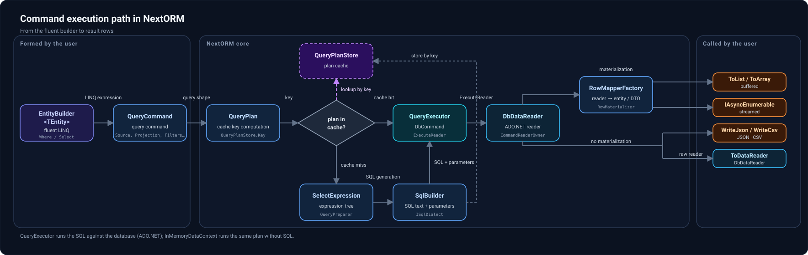

# Nextorm: типизированные SQL-запросы на C#, потоковая выгрузка и производительность

> Рабочий **русскоязычный черновик** для будущего поста с флейром `Showcase` в r/csharp. Перед публикацией — самостоятельная авторская редакция и перевод, а не дословная публикация этого текста.

Я давно разрабатываю [Nextorm](https://github.com/AlexeyShirshov/nextorm) — открытую ORM-библиотеку для .NET. Инструменты агентской разработки заметно ускорили работу, но для меня это по-прежнему самостоятельный инженерный проект. Недавно вышел **1.0.9 — первый стабильный релиз**, и я хотел бы показать не только результаты бенчмарков, но и то, как выглядит работа с библиотекой.

## Идея: не писать SQL-строки, но сохранить контроль над запросом

У Dapper меня всегда привлекала близость к SQL и небольшой overhead. С другой стороны, я хотел описывать запросы на C# с проверкой имён свойств и типов компилятором, IntelliSense и поддержкой рефакторинга. Так появился Nextorm: запрос строится из типизированных выражений, а SQL генерируется с учётом конкретной СУБД.

Например, простая выборка одной строки:

```csharp
var row = dataContext.From<SimpleEntity>()
    .Where(x => x.Id == 1)
    .Select(x => new { x.Id })
    .Single();
```

Здесь `SimpleEntity` — тип сущности, сопоставленный с таблицей. `Where` и `Select` задают части SQL-запроса; `Single()` выполняет его и материализует результат. Это **не стандартный LINQ-провайдер**: Nextorm использует собственный fluent API и деревья выражений C#.

## Что происходит между лямбдой и результатом

Fluent-вызовы формируют описание запроса. Далее Nextorm обрабатывает деревья выражений, подготавливает SQL и параметры через диалект выбранного провайдера, выполняет команду и сопоставляет строки с .NET-типами. В JIT-режиме выражения маппинга могут компилироваться в повторно используемые делегаты.



Чтобы не платить за построение одного и того же плана на каждом выполнении, есть **автоматический кеш планов по структуре запроса** и отдельный механизм `Prepare()` для явного переиспользования. Это разные режимы с разными правилами времени жизни и использования; [подробнее о них в документации](https://github.com/AlexeyShirshov/nextorm/blob/publish/docs/engine/03-plan-cache-and-reuse.md).

Библиотека работает с **SQLite, SQL Server, PostgreSQL, MySQL, MariaDB и ClickHouse**. Помимо базовых фильтров и JOIN, поддерживаются группировки, подзапросы, CTE, оконные функции и конструкции, специфичные для провайдера. При этом возможности и SQL-синтаксис разных СУБД, естественно, не полностью совпадают: [как обрабатываются различия провайдеров](https://github.com/AlexeyShirshov/nextorm/blob/publish/docs/guide/provider-specific-sql/overview.md).

## Пример, где не нужно создавать DTO для каждой строки

В Nextorm запрос можно не только превратить в список объектов. Его результат можно **записывать напрямую в `Stream` как JSON или CSV**, построчно, без создания отдельного DTO для каждой записи и без буферизации всей выборки. Например, в HTTP-обработчике:

```csharp
app.MapGet("/orders", async (
    HttpContext http,
    DateTime from,
    decimal minTotal,
    CancellationToken ct) =>
{
    using var ctx = new DataContextBuilder()
        .UsePostgres(connectionString)
        .CreateDataContext();

    http.Response.ContentType = "application/x-ndjson; charset=utf-8";

    await ctx.From<Order>()
        .Where(o => o.CreatedAt >= from && o.Total > minTotal)
        .Select(o => new { o.Id, o.CreatedAt, o.Total })
        .WriteJsonAsync(http.Response.Body, new JsonStreamOptions
        {
            Mode = JsonStreamMode.NdJson,
            IgnoreNull = true,
        }, ct);
});
```

Каждая строка превращается в отдельное JSON-значение (NDJSON) и отправляется в поток ответа. Для работы со строками по одной есть и `ToAsyncEnumerable()`; для низкоуровневого доступа можно использовать `DbDataReader`. [Документация по JSON/CSV streaming](https://github.com/AlexeyShirshov/nextorm/blob/publish/docs/guide/30-streaming-data.md).

## Несколько результатов измерений

Производительность была одной из целей с самого начала; ориентиром служил Dapper. Ниже — три сценария из **текущих отчётов SQLite async в ветке `publish`**. Меньше — лучше.

| Сценарий | Nextorm | Dapper | linq2db | EF Core |
|---|---:|---:|---:|---:|
| [Обычная выборка](https://github.com/AlexeyShirshov/nextorm/blob/publish/benchmarks/BenchmarkDotNet.Artifacts/results/NextORM.Benchmark.SqliteBenchmarkIteration-report-github.md) | **10.83 μs** | 15.80 μs | 16.50 μs | 38.46 μs |
| [Широкая выборка](https://github.com/AlexeyShirshov/nextorm/blob/publish/benchmarks/BenchmarkDotNet.Artifacts/results/NextORM.Benchmark.SqliteBenchmarkLargeIteration-report-github.md) | **9.135 ms** | 9.883 ms | 10.594 ms | 10.998 ms |
| [Выборка с WHERE](https://github.com/AlexeyShirshov/nextorm/blob/publish/benchmarks/BenchmarkDotNet.Artifacts/results/NextORM.Benchmark.SqliteBenchmarkWhere-report-github.md) | **915.0 μs** | 1,378.8 μs | 1,432.3 μs | 3,540.1 μs |

Это **не сравнение идентичных режимов исполнения**: для Nextorm здесь выбраны подготовленные запросы с генерацией SQL, для других библиотек — их наиболее быстрые измеренные варианты в указанных отчётах (включая compiled/streaming). Особенно важно, что `Prepare()` и обычный вызов с кешем плана имеют разную стоимость. Среда этих отчётов: **.NET 11.0.0, AMD EPYC 7763, BenchmarkDotNet 0.15.8, ShortRun, Linux**. Цифры относятся к конкретным сценариям и не означают, что Nextorm быстрее других ORM на любой задаче. [Сравнения и методология](https://alexeyshirshov.github.io/nextorm/comparisons/).

## Границы проекта и дальнейшая работа

У Nextorm **нет change tracking и `SaveChanges()`** — изменения данных выполняются явными запросами. Это сознательный выбор, поэтому библиотека не претендует на роль полной замены EF Core во всех сценариях. [Ограничения и возможности](https://github.com/AlexeyShirshov/nextorm/blob/publish/docs/advanced/limitations.md).

Есть также **экспериментальная частичная поддержка NativeAOT**: проверен ограниченный набор запросов для SQLite на .NET 11 под Linux x64. Нативный пример удалось собрать, включив `PublishAot=true`, без изменений прикладного кода. Поддержка остальных провайдеров и произвольных запросов под AOT пока не подтверждена. [Текущий статус NativeAOT](https://github.com/AlexeyShirshov/nextorm/blob/publish/docs/infrastructure/05-nativeaot.md).

Мне интересно мнение других C#-разработчиков: насколько естественным кажется такой API? Где, на ваш взгляд, явная генерация SQL из выражений полезнее ручного SQL или полноценного ORM с отслеживанием изменений? Критика и конкретные замечания приветствуются.

[Репозиторий Nextorm](https://github.com/AlexeyShirshov/nextorm) · [Документация](https://alexeyshirshov.github.io/nextorm/)
